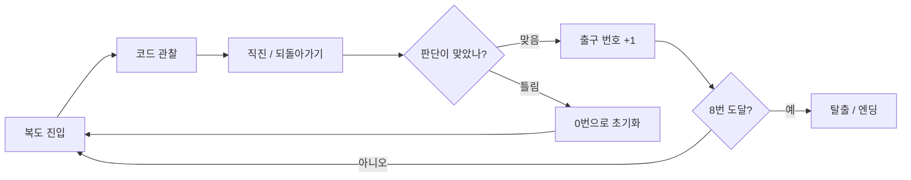

# 「8번 코딩」 게임 기획안

작성일: 2026-11-04 · 작성자: 정승원

## 1. 개요

「8번 코딩」은 『8번 출구』의 루프 구조를 빌려, 이상현상 대신 **코드 속 버그**를 찾아내는 1인칭 탐색 게임입니다. 목표는 **재미가 최우선**이고, 학습 효과는 그 결과로 따라오도록 설계합니다.

| 항목 | 내용 |
| --- | --- |
| 장르 | 1인칭 루프형 관찰·판단 게임 |
| 핵심 경험 | 걸으면서 벽의 코드를 읽고, 버그가 있는지 의심하고 판단하는 긴장감 |
| 원작과의 대응 | 이상현상 = 버그, 복도 = 코드 한 세트, 출구 번호 = 연속 정답 수 |
| 차별점 | 엉뚱한 문제, 보스 복도, 가끔 틀리는 AI 도우미 |
| 대상 | 코딩을 처음 배우는 사람부터 이미 배운 사람까지 (난이도 선택) |
| 1차 지원 언어 | Python (이후 확장) |

원작을 오마주하되, 이름·로고·연출은 팀이 직접 창작한 것으로 구성합니다.

## 2. 핵심 규칙과 게임 루프

플레이어는 같은 복도를 반복해서 걸으며 코드를 보고, **버그가 있으면 되돌아가고 없으면 직진**합니다. 8번 연속으로 맞히면 탈출합니다.

벽 포스터의 규칙:

1. 버그를 놓치지 말 것
2. 버그를 발견하면 즉시 되돌아갈 것
3. 버그가 없으면 되돌아가지 말 것
4. 8번 출구로 나갈 것

### 게임 루프

틀리면 어느 번호에 있든 0번으로 돌아가고, 정답이어도 8번 전까지는 같은 복도에 다시 들어갑니다.

### 판정표

| 버그 | 플레이어 선택 | 결과 |
| --- | --- | --- |
| 있음 | 되돌아감 | 정답 → +1 |
| 있음 | 직진 | 오답 → 0 |
| 없음 | 직진 | 정답 → +1 |
| 없음 | 되돌아감 | 오답 → 0 |

## 3. 난이도 설계

난이도는 **3단계 + 엔딩 후 해금되는 숨김 모드**로 구성하고, 단계마다 50문제 이상(총 150문제 이상)을 목표로 합니다.

| 단계 | 대상 | 주요 버그 유형 | 코드 길이 | 문제 수 |
| --- | --- | --- | --- | --- |
| 하 (입문) | 처음 배우는 사람 | 문법, `=`/`==`, 출력 오타 | 3~6줄 | 50+ |
| 중 (초급) | 기초를 배운 사람 | 경계값, 무한 루프, 타입 | 6~12줄 | 50+ |
| 상 (중급) | 이미 배운 사람 | 스코프, 참조/값, 알고리즘 논리 | 10~20줄 | 50+ |
| ??? (숨김) | 엔딩 후 해금 | 보스 문제 연속 출제 | 자유 | 기존 보스 문제 재활용 |

- **코드 길이**는 복도 하나를 지나는 20~30초 안에 걸으면서 읽을 수 있는 분량을 기준으로 한 예시입니다. 플레이테스트로 조정합니다.
- 6단계(입문자/경험자 × 상중하)도 검토했지만, 300문제 이상이 필요해 게임성을 다듬을 시간이 부족해질 위험이 커서 3단계를 추천합니다.
- 출구 번호가 올라갈수록 같은 단계 안에서도 어려운 문제가 나오도록, 문제마다 세부 난이도(1~3)를 두는 방식도 고려해 볼 만합니다.

## 4. 언어 지원 계획

언어는 게임 시작 화면에서 선택하며, **1차는 Python 하나로 시작하고 데이터 구조는 처음부터 다국어를 고려**합니다.

| 단계 | 언어 | 이유 |
| --- | --- | --- |
| 1차 (MVP) | Python | 입문자가 가장 많이 배우고, 코드가 짧아 벽에 표시하기 좋음 |
| 2차 확장 | C 또는 Java | 학교·자격증에서 많이 다루고, 세미콜론·타입 등 버그 종류가 풍부함 |
| 선택 | C# | Unity로 개발한다면 팀원에게도 익숙한 언어 |

문제 제작량을 줄이는 방법:

- **언어 공통 문제 + 언어별 코드**: 문제 하나(개념, 해설, 버그 유형)에 언어별 코드 텍스트만 따로 붙입니다.
- **템플릿 변형**: 하나의 문제에서 변수 이름, 숫자, 버그 위치만 바꿔 여러 문제를 만듭니다.
- **언어 전용 문제**: Python 들여쓰기 버그처럼 특정 언어에만 있는 문제는 그 언어에서만 출제합니다.

## 5. 이상현상(버그) 문제 설계

이상현상은 네 가지 문제 유형을 **출구 번호에 따라 섞어서** 출제합니다. 초반은 눈으로 찾기 쉬운 문제, 후반은 코드를 머릿속으로 실행해야 하는 문제입니다.

### 문제 유형

| 유형 | 방식 | 주로 나오는 구간 |
| --- | --- | --- |
| 세계 = 코드형 | 복도 입구의 코드(예: `lights = 6`)와 실제 복도가 다르면 이상현상 | 출구 0~2 |
| 코드 리뷰형 | 벽 모니터의 코드에 버그가 숨어 있음 | 출구 3~5 |
| 출력 예측형 | 코드의 실행 결과와 "실행 결과" 표지판이 다르면 이상현상 | 출구 6~8 |
| 엉뚱한 문제 | 코드 내용과 복도의 오브젝트·소리가 연동됨 | 전 구간 (가끔) |

### 버그 카테고리

| 카테고리 | 예시 | 난이도 |
| --- | --- | --- |
| 문법 | 세미콜론 누락, 괄호 짝 안 맞음 | 하 |
| 비교/대입 | `=`와 `==` 혼동 | 하 |
| 경계값 | `<=`와 `<` (off-by-one) | 중 |
| 무한 루프 | 증감식 누락, 항상 참인 조건 | 중 |
| 타입 | 정수 나눗셈 | 중 |
| 스코프 | 변수 선언 위치 | 상 |
| 참조/값 | 리스트·배열 복사 문제 | 상 |

### 엉뚱한 문제 예시

- 코드를 실행하면 ASCII 고양이가 나오는데, 벽 포스터의 고양이는 수염이 하나 모자람
- `print("안녕하세요")`를 100번 출력하는 코드인데, 복도 안내 방송은 99번만 반복됨
- 변수 이름이 전부 `아저씨1`, `아저씨2`지만 버그는 없음 (수상해 보이는 정상 코드 = 함정)
- 코드 속 주석이 플레이어에게 말을 걸음: `# 뒤를 돌아보지 마`

원작처럼 **"정상인데 수상해 보이는" 코드**를 충분히 섞어야 직진/되돌아가기 판단에 긴장감이 생깁니다.

## 6. 특수 이벤트

두 가지 이벤트가 일반 루프에 변화를 줍니다. **보스 복도**와, 가끔 틀리는 **AI 도우미**입니다.

### 보스 복도

- 특정 출구 번호에 도달하거나 무작위로 등장합니다.
- 조명이 빨간색으로 바뀌고 타이머가 생기는 등 분위기가 전환됩니다.
- 플레이어가 풀기 어려운 알고리즘 문제를 일부러 출제합니다.
- 보스 문제는 숨김 모드에서 재활용합니다.

### AI 도우미: "믿을 수 없는 도우미"

AI 캐릭터가 문제를 풀어주지만 **가끔 틀린 답(환각)을 냅니다.** 플레이어는 AI의 답을 믿고 직진할지, 의심하고 되돌아갈지 판단합니다. AI 도우미 자체가 또 하나의 이상현상이 되는 구조입니다.

| 항목 | 제안 (플레이테스트로 조정) |
| --- | --- |
| 등장 조건 | 보스 문제에서 일정 시간 경과, 또는 같은 출구에서 연속 실패 |
| 정답률 | 난이도 하는 높게, 상은 낮게 (예: 90% → 60%) |
| 틀릴 때의 단서 | 말투가 미묘하게 이상함, 눈 색깔 변화, 지나치게 자신만만한 대사 |
| 플레이어 선택 | AI 답을 믿고 직진 / 의심하고 되돌아가기 (원작 규칙 그대로) |
| 엔딩 연동 | AI 의존 횟수에 따라 엔딩 분기 |

- **캐릭터**: 이름과 디자인은 자체 창작합니다(예: 코봇, AI-8, 자동완성 씨). 항상 자신만만하고 친절하지만 가끔 그럴듯한 거짓말을 합니다.
- **공정성**: 완전히 무작위로 틀리면 불공정하게 느껴집니다. "그때 눈치챘어야 했는데!"라고 느낄 수 있는 단서를 반드시 남깁니다.

## 7. 재미 요소와 연출

공포는 점프스케어보다 **"익숙한 것이 미묘하게 다르다"**는 감각에서 나오고, 웃음은 개발자라면 공감할 밈에서 나옵니다.

| 요소 | 내용 |
| --- | --- |
| NPC 아저씨 = 시니어 개발자 | 지나가면서 혼잣말로 힌트를 주거나, 틀린 힌트를 줌 |
| 스택 오버플로 복도 | 무한 루프 문제를 놓치면 복도가 끝없이 길어짐 |
| 컴파일 에러 점프스케어 | 문법 버그를 지나치면 빨간 에러 메시지가 화면을 덮음 |
| 실패 시 해설 | 0번으로 돌아갈 때 "3번째 줄의 `<=`"처럼 놓친 버그를 보여줌 |
| 버그 도감 | 발견한 버그 유형을 수집 |
| 엔딩 분기 | AI 의존 횟수에 따라 다른 엔딩 |

분위기 연출은 형광등 조명, 약한 블룸과 비네트, 환풍기 소리 같은 환경음으로 구성합니다. 정상 상태의 복도를 정교하게 만들수록 이상현상이 더 잘 드러납니다.

## 8. 구현 기능 목록

원작의 루프·판정 구조는 거의 그대로 쓰고, **문제 데이터와 코드 표시**가 새로 추가됩니다. 답안이 아니라 팀이 설계할 때 고민해야 할 질문을 함께 적었습니다.

| 기능 | 내용 | 고민할 점 | 단계 |
| --- | --- | --- | --- |
| 1인칭 컨트롤러 | 이동, 시점, 발소리 | 이동 속도가 코드를 읽는 시간에 어떤 영향을 줄까? | MVP |
| 무한 루프 복도 | 양쪽 트리거, 끊김 없는 텔레포트 | 상대 좌표 유지, 트리거 중복 발동 방지 | MVP |
| GameManager | 출구 번호, 판정, 엔딩 조건 | 트리거가 직접 상태를 바꿀까, 이벤트만 알릴까? | MVP |
| 난이도·언어 선택 화면 | 시작 시 설정 | 선택값을 씬이 바뀌어도 어떻게 유지할까? | MVP |
| 문제 데이터베이스 | 코드, 버그 여부·위치, 해설, 난이도, 언어 | JSON? ScriptableObject? 다국어 필터링 구조는? | MVP |
| 문제 선택 로직 | 난이도별 풀, 중복 방지, 정상/버그 비율 | "버그 없음"이 몇 %일 때 재미있을까? | MVP |
| 코드 표시 | 벽 모니터의 코드, 문법 강조 | 3D 공간에서 글자가 잘 읽히는 크기는? | MVP |
| 세계 = 코드 연동 | 코드 값과 실제 오브젝트 상태 연결 | 코드의 `lights = 6`을 실제 조명 수에 어떻게 반영할까? | MVP |
| 출구 번호 표지판 | 0~8 표시, 8에서 출구로 변경 | | MVP |
| 실패 해설 UI | 놓친 버그 표시 | 어느 타이밍에 보여주면 흐름이 안 끊길까? | MVP |
| 보스 이벤트 | 타이머, 조명 전환, 고난도 문제 | 일반 복도와 다른 규칙을 어떻게 끼워 넣을까? | MVP |
| AI 도우미 | 등장 조건, 대사, 환각 확률, 단서 연출 | 틀릴 때의 단서를 데이터로 어떻게 표현할까? | MVP |
| NPC 아저씨 | 이동, 힌트 대사 | | 2차 |
| 버그 도감 | 발견 기록, 저장 | 무엇을 저장해야 할까? | 2차 |
| 숨김 모드·엔딩 분기 | 해금 조건, 보스 문제 연속 | | 2차 |
| 연출·사운드·UI | 타이틀, 설정, 점프스케어 | | MVP~2차 |

## 9. 개발 로드맵

MVP는 난이도 3단계 × Python × 보스 이벤트와 AI 도우미까지이고, 문제 수 늘리기와 숨김 모드는 2차로 미룹니다.

| 단계 | 범위 | 내용 | 다음 단계로 가는 관문 |
| --- | --- | --- | --- |
| 1단계 · 뼈대 | MVP | 이동과 루프 복도, 판정과 출구 번호, 문제 없이 로그로 확인 | 루프가 자연스러운가 |
| 2단계 · 문제 시스템 | MVP | 문제 데이터 구조, 벽 모니터 코드 표시, 단계별 10문제로 시험 | 판단이 재미있는가 |
| 3단계 · 이벤트 | MVP | 보스 복도, AI 도우미(환각), 실패 해설 UI | 플레이테스트 통과 |
| 4단계 · 확장 | 2차 | 단계별 50문제 이상, NPC·도감·숨김 모드, 두 번째 언어 | |

각 단계 사이의 관문(마름모)을 통과해야 다음 단계로 넘어가고, 문제는 재미가 확인된 뒤에 본격적으로 늘립니다.

## 10. 리스크와 주의사항

가장 큰 리스크는 **문제 제작량**입니다. 문제 만드는 데 시간이 몰리면 재미를 다듬을 시간이 줄어듭니다.

| 리스크 | 대응 |
| --- | --- |
| 150문제 이상 제작 부담 | 템플릿 변형, 언어 공통 문제 구조, MVP는 단계별 일부부터 |
| 코드가 길면 "걷는 게임"이 "읽는 문제집"이 됨 | 줄 수 제한, 플레이테스트로 검증 |
| AI 도우미가 불공정하게 느껴짐 | 틀릴 때 관찰 가능한 단서 남기기 |
| 이전 문제의 상태가 다음 복도에 남는 버그 | 문제마다 적용과 원상복구를 한 쌍으로 설계 |
| 상표·저작권 문제 | 실제 AI 제품명·로고, 원작 에셋 미사용. 오리지널 캐릭터와 연출로 제작 |

### 팀이 정해야 할 것

- [ ] 난이도 3단계로 확정할지
- [ ] 개발 엔진 확정 (Unity 등)
- [ ] 문제 데이터 형식 (JSON / ScriptableObject 등)
- [ ] "버그 없음" 복도의 비율
- [ ] AI 캐릭터의 이름과 디자인
- [ ] 팀원별 역할 분담 (문제 제작 / 시스템 / 연출)
