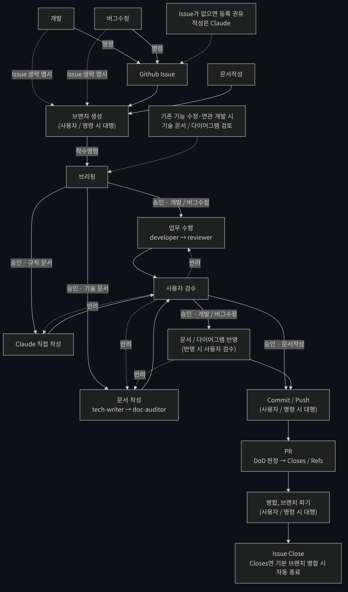

# Workflow 규칙

> Claude가 업무 수행 시 지켜야 하는 업무 프로세스
>
> 해당 문서에 기재되지 않은 업무가 발생한 경우, 이 지침에 대한 개선을 사용자에게 권유한다.
>
> 흐름의 단일 출처는 이 문서의 본문이다. `WorkflowDiagram.png`는 사람이 보는 참고용이며, 본문과 다르면 본문을 따른다.

---

## 0. 전체 흐름

> 업무는 아래 순서로 진행하며, 사용자의 명령 / 승인 없이 다음 단계로 넘어가지 않는다.



명령 → Github Issue → 브랜치 생성 → 착수명령 → 브리핑 → 업무 수행 → 사용자 검수 → 문서 / 다이어그램 반영 → Commit / Push → PR → 병합, 브랜치 파기 → Issue Close

- 각 단계의 종료 보고 끝에는 다음 단계와 수행 주체를 적는다. (예: `다음 단계 : Commit / Push (사용자)`)

### 역할 구분

| 단계 | 수행 주체 |
|---|---|
| 업무 명령, 착수명령, 검수 (승인 / 반려) | 사용자 |
| Github Issue 작성, 브리핑, 업무 수행, 문서 / 다이어그램 반영, PR 작성 | Claude |
| 브랜치 생성, Commit / Push, 병합, 브랜치 파기, Issue Close | 사용자 (명시적 명령이 있으면 Claude 대행 가능) |

### Git / gh 권한

> 적용 수준은 `Docs/TechSpec.md` `4. 워크플로우 설정`의 `Git 권한`을 따른다. 아래 표는 `표준` 수준이다.

| 구분 | 명령 |
|---|---|
| Claude 상시 허용 | 읽기 전용 Git(`status`, `diff`, `log`, `branch --show-current`, `branch --list`, `rev-parse`, `merge-base`, `ls-remote`), `gh issue create / view / list`, `gh pr create`, `gh label create` |
| 사용자 수행, 명시적 명령 시 Claude 대행 | `add`, `commit`, `push`, `stash`, `switch` / `checkout`, 브랜치 생성 / 삭제, 작업 브랜치에서의 로컬 `merge`, `fetch`, `pull --ff-only`, `gh pr merge`, `gh issue edit`, `gh issue close` |
| 금지 | 보호 브랜치에 직접 commit / push / 로컬 merge (`CLAUDE.md` 절대 원칙 1), force push, `reset --hard` |

- `제한` 수준이면 "명시적 명령 시 Claude 대행" 명령을 실행하지 않고, 실행할 명령만 안내한다.
- 서브에이전트(`developer`, `reviewer`, `tech-writer`, `doc-auditor`)는 Git, gh를 실행하지 않는다. 필요한 변경 내용(diff)은 메인이 입력으로 전달한다.

### 용어

- **착수명령** : 특정 Issue 또는 작업의 진행을 지시하는 사용자 발화. 이미 있는 Issue를 지목한 명령(예: "#5 고쳐줘")도 착수명령으로 본다.
- **승인** : 브리핑 등 확인 요청에 대한 사용자의 명시적 동의.
  - 응답에 조건이 붙은 경우, 브리핑 범위 안의 값만 정하는 조건(예: "속도는 5로")은 반영한 뒤 변경점만 확인받는다. 작업 범위가 바뀌는 조건이면 다시 브리핑한다.
- **명시적 명령** : 사용자가 특정 Git / gh 작업을 하라고 지시한 것. Claude가 실행할 명령을 제시하고 물었을 때 사용자가 "예"라고 답한 것도 명시적 명령으로 본다.
- **반려** : `6. 사용자 검수`에서 사용자가 결과를 거부하는 것.
- **지적 사항** : 검수 에이전트가 `수정 필요`로 판정한 내용. `reviewer`는 `위반 사항`, `doc-auditor`는 `불일치 사항`으로 출력한다.

### 교육 모드

- `Docs/TechSpec.md` `4. 워크플로우 설정`의 `교육 모드`가 `켬`이면, 메인 Claude는 사용자에게 보내는 설명, 질문 답변, 검수 요청(`5. 업무 수행 (업무 착수) > 검수 요청`)에서 완성된 코드·문장 대신 위치, 근거, 수정 방향까지만 제시한다.
- 파일 산출물(소스코드, 문서, Issue / PR 본문)과 에이전트끼리 주고받는 내용에는 적용하지 않는다. 검수 에이전트의 출력을 사용자에게 전달할 때 위 형태로 바꾸는 것은 메인이 한다.

---

## 1. 업무 유형

> 업무 유형에 따라 브리핑까지의 진입 경로와 이후 경로가 다르다.

| 업무 유형 | 진입 경로 | 이후 경로 |
|---|---|---|
| 개발 | 명령 → Github Issue → 브랜치 생성 → 착수명령 → 브리핑 | 5. 업무 수행 → 6. 사용자 검수 → 7. 문서 / 다이어그램 반영 → 8. Commit / Push |
| 버그수정 | 명령 → Github Issue → 브랜치 생성 → 착수명령 → 브리핑 | 5. 업무 수행 → 6. 사용자 검수 → 7. 문서 / 다이어그램 반영 → 8. Commit / Push |
| 문서작성 | 브랜치 생성 → 착수명령 → 브리핑 (Docs Label Issue가 있으면 연결) | 기술 문서 : 7장 절차로 작성, 규칙 문서 : Claude 직접 작성 → 6. 사용자 검수 → 8. Commit / Push |

- Issue Label과 업무 유형의 대응은 `Docs/Documentation/GithubIssueRule.md` `7. 기타`의 대응표를 따른다.
- 개발, 버그수정 명령을 받으면 연결된 Issue가 있는지 먼저 확인한다. (`gh issue list --search`, `gh issue view` 또는 사용자 확인)
  - 연결된 Issue가 없다면 `2. Github Issue` 단계를 거친다.
  - 사용자가 Issue를 생성하지 않도록 명시한 경우, Issue 단계를 생략한다.
- 브리핑 전, `git branch --show-current`로 현재 브랜치를 확인한다.
  - 보호 브랜치(`CLAUDE.md` 절대 원칙 1)이면 `Docs/Documentation/GithubBranchRule.md` `2. 이름 형식`에 따른 브랜치명을 제안하고, 사용자가 브랜치를 만든 뒤(또는 대행 명령 후) 브리핑한다.
  - 작업 브랜치이지만 이름의 접두사나 이슈번호가 착수한 작업과 맞지 않으면, 그 브랜치에서 진행할지 사용자에게 묻는다.
- 브리핑 생략 예외 : 업무 유형에 속하지 않는 오타, 서식 수정은 브리핑 양식 없이 변경 예정 내용을 보여 주고 승인받은 뒤 수정한다.

---

## 2. Github Issue

> 이슈로 등록할 필요가 있다고 판단하는 경우 사용자에게 작성을 권유하며, 실질적인 작성은 Claude가 수행한다.

- 아래의 경우, 사용자에게 이슈 작성을 권유한다.
  1. 개발, 버그수정 명령에 연결된 Issue가 없는 경우.
  2. 업무 수행 중, 작업 범위 밖의 버그나 개선점을 발견한 경우.
  3. 하나의 요청이 여러 기능 단위로 나뉘어야 하는 경우. (나누는 기준은 `Docs/TechSpec.md` `4. 워크플로우 설정`의 `Issue 묶음 단위`)
- 이슈 등록 여부는 사용자가 결정한다.
- 이슈 작성은 `/github-issue` 스킬을 호출해 수행한다.
- 이슈 등록 후, 사용자의 **착수명령**이 있을 때까지 브리핑으로 넘어가지 않는다.
- `Docs/TechSpec.md` `4. 워크플로우 설정`의 `Issue 담당자 지정`이 `켬`이면, 착수명령을 받을 때 연결 Issue의 Assignees를 사용자로 지정할지 함께 묻는다. (`gh issue edit <번호> --add-assignee @me`)

---

## 3. 기술 문서 / 다이어그램 검토

> 기존의 기능을 수정하거나 연관된 기능을 개발하는 경우, 기존에 작성된 기술 문서와 다이어그램을 검토한 후 작업계획을 수립한다.

- 다이어그램은 선택 사항이며, 없으면 생략한다.
- 검토한 문서는 브리핑의 `참고 문서` 항목에 기재한다.
- 기술 문서와 실제 코드의 대조는 `doc-auditor` 에이전트에 대상 문서와 관련 소스 파일 목록을 전달해 수행한다.
- 문서와 실제 코드의 내용이 다르면, 차이점을 보고하고 어느 쪽을 기준으로 할지 사용자에게 질문한다.
- 관련 문서가 없으면 `참고 문서` 항목에 "없음"으로 기재한다.

---

## 4. 브리핑

> 착수명령을 받으면 바로 작업하지 않고, 아래 양식으로 브리핑한 뒤 **승인**을 받고 착수한다. (생략 예외는 `1. 업무 유형`)

- 브리핑의 작업 범위는 Issue의 `작업 내용`, `완료조건 (DoD)`과 일치해야 하며, 다르다면 차이를 명시한다.
  - Issue에 DoD가 없으면 브리핑에 DoD 초안을 넣고, Issue에도 반영할지 사용자에게 묻는다. (`gh issue edit`)
- enum을 추가하는 작업의 파일 목록은 `Docs/Code/CodeConvention.md` `2. enum`을 따른다.
- 파일 삭제는 사용자가 수행한다. (`Assets/` 아래는 Unity 에디터에서, `Docs/Code/FolderStructure.md` `규칙`)
- 코드가 아닌 에셋(`.inputactions`, 프리팹, 씬)이나 에디터 설정(ProjectSettings, 패키지) 작업을 누가 할지는 `확인 필요 사항`에서 정한다. Claude가 할 수 없는 작업은 사용자가 수행하고 Claude는 절차를 안내한다. `Docs/TechSpec.md`의 `Unity MCP 사용`이 `켬`이면 `Docs/Claude/ClaudeCodeRules.md` `Unity MCP 사용 규칙 > 변경`을 따른다.

```markdown
## 브리핑 : [작업명]

**연결 Issue** : [#번호 / 없음]
**참고 문서** : [문서 경로 / 없음]

**작업 범위**
- (구현 / 작성 내용 요약)

**생성/수정/삭제 파일**
- 생성 : `파일경로` (역할)
- 수정 : `파일경로` (변경 내용)
- 삭제(사용자 수행) : `파일경로`

**작업 순서**
1. [단계명] -> 확인 : [확인 항목], [확인 항목]
2. [단계명] -> 확인 : [확인 항목]

**확인 필요 사항**
- (가정, 모호한 요구사항, 선택지)

진행할까요?
```

---

## 5. 업무 수행 (업무 착수)

> 승인받은 브리핑의 작업 범위 안에서만 작업한다.

- 작업 범위는 `Docs/Claude/ClaudeCodeRules.md`의 `작업 범위 규칙`을 따른다.
- 소스코드 작성 시 `Docs/TechSpec.md`, `Docs/Code/CodeConvention.md`, `Docs/Code/FolderStructure.md`를 따른다.
- 소스코드 작업은 아래 `검수 반복` 절차로 수행한다. (작성자 : `developer`, 검수자 : `reviewer`)

### 검수 반복

1. 작성자에게 승인된 브리핑을 전달해 작업한다.
2. 검수자에게 브리핑, 작성자의 작업 보고, 변경 내용을 전달해 검수한다. (검수자 입력이 따로 정해진 장은 그 장을 따른다)
   - Unity MCP가 켬이고 `새로고침 도구`(`Docs/TechSpec.md` `5. 도구 연결`)가 있으면, 검수자를 호출하기 전에 메인이 실행한다.
   - 변경 내용 : 메인이 `git diff $(git merge-base <기준 브랜치> HEAD) -- <브리핑의 파일들>`과 `git status --porcelain -uall`로 확인한 diff. 새 파일은 전문을 전달한다.
3. 판정이 `수정 필요`면 지적 사항과 직전 작업 보고를 작성자에게 전달해 재작업하고, 다시 검수한다.
4. 판정이 `통과`면 검수 결과(제안, 미검증 항목 포함)를 덧붙여 사용자에게 검수를 요청한다.
5. 재작업은 최대 3회다. 3회째 재작업 뒤에도 `수정 필요`면 반복을 멈추고, 남은 지적 사항과 반복 원인을 사용자에게 보고한다. 이 횟수는 `6. 사용자 검수`의 반려가 있을 때마다 0부터 다시 센다.
6. 작성자가 아래 중단 조건으로 멈추면, 검수를 거치지 않고 작성자의 보고를 그대로 사용자에게 전달한다.
7. 브리핑에 Unity MCP 변경 작업이 있고 아직 적용하지 않았거나 재작업으로 다시 필요하면, 4번의 검수 요청 전에 메인이 수행한다. (`Docs/Claude/ClaudeCodeRules.md` `Unity MCP 사용 규칙 > 변경`)

### 중단 조건

- 아래의 경우, 작업을 멈추고 사용자에게 보고한다.
  1. 브리핑에 없던 파일의 생성 / 수정 / 삭제가 필요한 경우.
  2. 브리핑의 작업 순서나 방식이 바뀌어야 하는 경우.
  3. 현재 작업을 진행할 수 없게 만드는 범위 밖 문제를 발견한 경우.
- 현재 작업을 막지 않는 범위 밖 문제는 수정하지 않고 기록해 두었다가 작업 보고에 적는다. 메인은 검수 요청 때 이를 보고하고, 필요하면 Issue 등록을 권유한다.
- 3번으로 멈춘 경우, 메인은 사용자에게 아래 선택지를 제시한다.
  1. 범위를 넓혀 다시 브리핑한다.
  2. 별도 Issue와 브랜치에서 그 문제를 먼저 해결한다. 이때 커밋하지 않은 변경은 WIP 커밋이나 `stash`로 보존한다. (대행 명령)
- 중단 후 재개 : 사용자가 변경된 브리핑을 승인하면, 변경된 브리핑과 중단 보고를 작성자에게 전달해 재개한다.

### 작업 보고

> 작성자 → 메인


- 상태 : 완료 / 중단
- 생성 / 수정 / 삭제한 파일 목록
- 브리핑의 단계별 확인 항목 결과 (`ClaudeCodeRules.md` `행동 원칙 > 1. 사고 우선 (Think Before Coding)`의 검증 등급)
- 사용자가 Unity 에디터에서 직접 확인해야 할 항목
- 범위 밖 발견 사항 (있는 경우)
- 중단인 경우 : 완료한 단계, 남은 단계, 수정 중이던 파일

### 검수 요청

> 메인 → 사용자


- 작업 보고의 내용, 검수자의 검수 결과(제안, 미검증 항목), 범위 밖 발견 사항
- Unity MCP로 바꾼 대상과 내용, 바꾼 뒤 조회 결과와 등급 (있는 경우)
- 다음 단계와 수행 주체
- 교육 모드가 `켬`이면 `0. 전체 흐름 > 교육 모드`를 따른다.

---

## 6. 사용자 검수

> 사용자는 검수 결과로 **승인** 또는 **반려**를 결정하며, Claude는 명시적인 승인 없이 다음 단계로 넘어가지 않는다.

### 반려

- 반려 사유가 브리핑의 작업 범위 안이면, 사유를 정리해 보고한 뒤 바로 재작업한다. 직전 단계의 작성자(`developer`, `tech-writer`, 또는 규칙 문서를 직접 작성한 Claude)에게 반려 사유를 포함해 돌려보낸다.
- 반려 사유가 브리핑의 작업 범위를 벗어나면, 다시 브리핑하고 승인을 받는다.
- 같은 사유로 2회 반려되면, 원인과 다른 접근 방법을 사용자에게 제시한다.

### 승인

- 개발 / 버그수정은 `7. 문서 / 다이어그램 반영`으로, 문서작성은 `8. Commit / Push`로 넘어간다.
- DoD 판정은 `9. PR`에서 한다.

---

## 7. 문서 / 다이어그램 반영

> 승인된 작업으로 인해 기존 문서의 내용이 실제와 달라졌다면 해당 문서를 갱신한다.

- 새 public 클래스나 Inspector에서 설정할 항목이 생긴 기능이면, 기술 문서 작성을 사용자에게 권유한다. 권유할 때 작성할 문서 경로를 함께 제시하며, 승인받으면 그 경로가 작성 대상이 된다.
- 문서의 생성 / 수정도 사용자의 승인 후 진행한다. (`CLAUDE.md` 절대 원칙 2) `문서작성` 업무는 승인된 브리핑이 이 승인을 겸한다.
- 기술 문서의 양식과 작성 규칙은 `Docs/Documentation/TechDocRule.md`를 따른다.
- 다이어그램은 선택 사항이며, 없으면 생략한다.
- 기술 문서의 작성 / 갱신은 `5. 업무 수행 (업무 착수) > 검수 반복` 절차로 수행한다. (작성자 : `tech-writer`, 검수자 : `doc-auditor`)
  - 작성자 입력 : 개발 / 버그수정은 승인된 브리핑, `developer`의 작업 보고, `reviewer`의 검수 결과. 문서작성은 승인된 브리핑과 관련 소스 파일 목록.
  - 검수자 입력 : 승인된 브리핑, 작성된 문서, 관련 소스 파일 목록.
- 기술 문서가 아닌 문서(규칙 문서 등)는 서브에이전트 없이 Claude가 직접 작성한다.
- 개발 / 버그수정에서 문서를 반영했으면 사용자 검수(`6. 사용자 검수`와 같은 방식)를 받은 뒤 `8. Commit / Push`로 넘어간다.
- 반영할 문서가 없으면 "반영할 문서 없음"으로 보고하고 `8. Commit / Push`로 넘어간다.

---

## 8. Commit / Push

> 사용자가 수행한다. 명시적 명령이 있으면 Claude가 대행할 수 있다. (`0. 전체 흐름 > Git / gh 권한`)

- 사용자가 요청하면 `git status`로 이번 작업의 변경 파일과 관계없는 파일이 섞였는지 보고한다.
- 커밋 메시지는 `[말머리] 요약 (#이슈번호)` 형식으로 적는다. 말머리는 `Docs/Documentation/GithubIssueRule.md` `7. 기타`의 대응표를 따르고, Issue가 없으면 `(#이슈번호)`를 생략한다.

---

## 9. PR

> 사용자가 요청하면 Claude가 작성한다.

- PR 작성은 `/github-pr` 스킬을 호출해 수행한다.
- 변경 파일 목록은 `git diff --name-only <기준 브랜치>...HEAD`를 기준으로 하고, `5. 업무 수행 (업무 착수)`와 `7. 문서 / 다이어그램 반영`의 보고와 대조한다.
  - 생성 / 삭제한 파일과 짝을 이루는 `.meta` 파일은 같은 파일로 본다. 새로 만든 폴더의 `.meta`는 그 폴더 안에서 생성한 파일과 같은 작업으로 본다. 생성한 파일의 `.meta`가 diff에 없으면 커밋 누락으로 보고한다.
- DoD 판정은 `Docs/Documentation/GithubPRRule.md` `2. 연결 Issue`를 따른다.
- 사용자의 승인 없이 PR을 생성하지 않는다.

---

## 10. 병합, 브랜치 파기

> 사용자가 수행한다. 명시적 명령이 있으면 Claude가 대행할 수 있다. (`0. 전체 흐름 > Git / gh 권한`)

- 병합은 `gh pr merge --<방식> --delete-branch`로 한다. 방식은 `Docs/TechSpec.md` `4. 워크플로우 설정`의 `병합 방식`을 따른다.
- 이 명령은 작업 브랜치 삭제를 포함하므로, 병합 승인이 브랜치 삭제 승인을 겸한다.
- 병합 후 `git branch --show-current`, `git branch --list <작업 브랜치>`로 상태를 확인하고, 남은 정리만 수행한다. (기준 브랜치로 `switch`, `pull --ff-only`, 남은 로컬 작업 브랜치 삭제)

---

## 11. Issue Close

> PR 본문의 연결 방식에 따라 처리한다.

- `Closes #번호`로 연결된 Issue는 PR이 GitHub 기본 브랜치에 병합될 때 자동으로 닫힌다.
  - 기준 브랜치가 GitHub 기본 브랜치가 아니면(예: Develop 사용) 자동으로 닫히지 않는다. 병합 후 `gh issue close`를 안내한다. (대행 명령)
- `Refs #번호`로 연결된 Issue는 DoD 미충족 항목이 있다는 뜻이다. 미충족 항목을 별도 Issue로 등록할지 사용자에게 질문하고, Close는 사용자가 결정한다.
- 이슈가 없는 업무는 이 단계를 생략한다.
